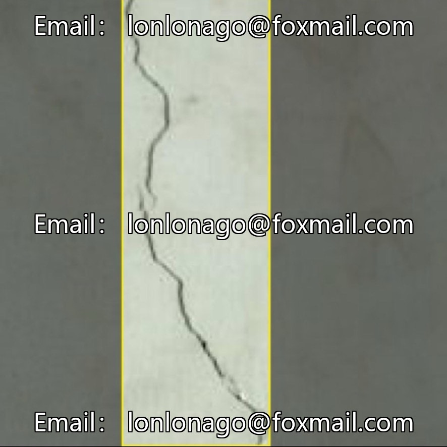
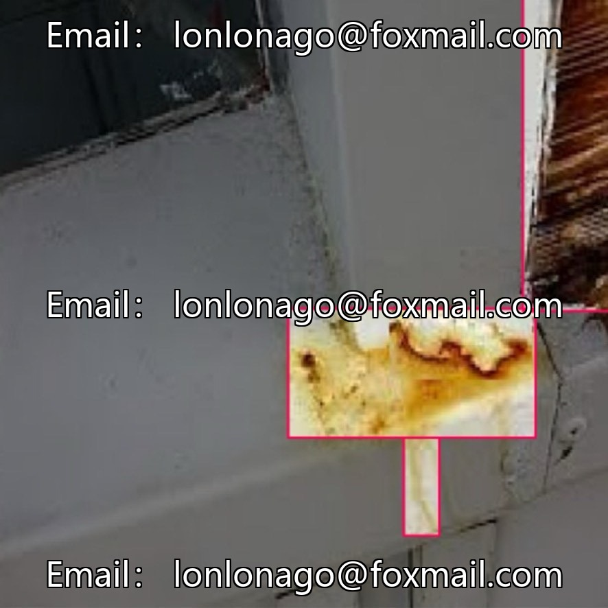
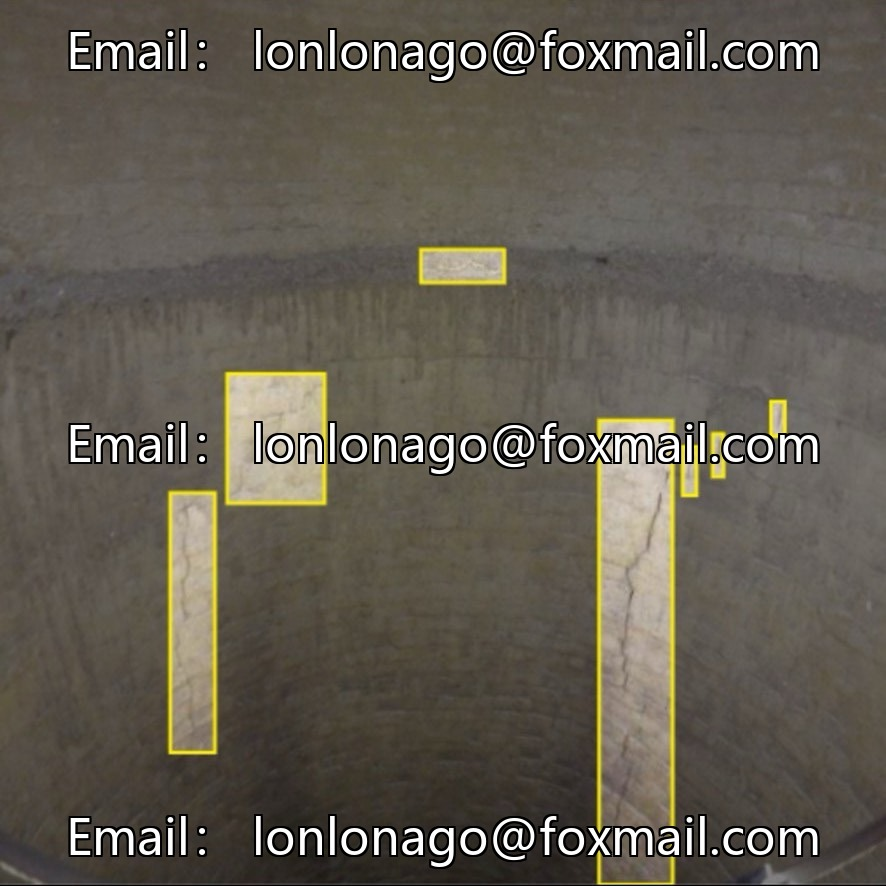
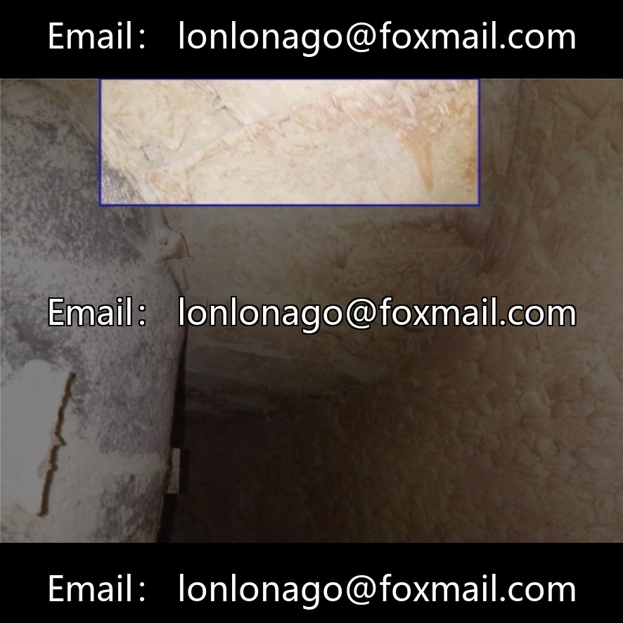
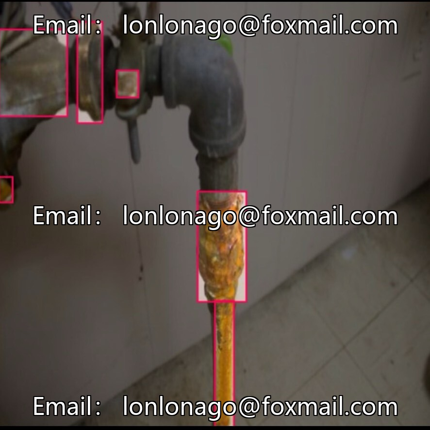
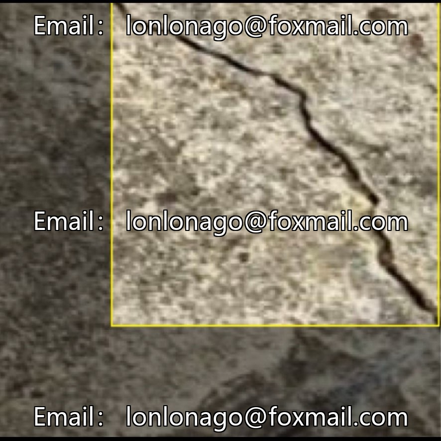
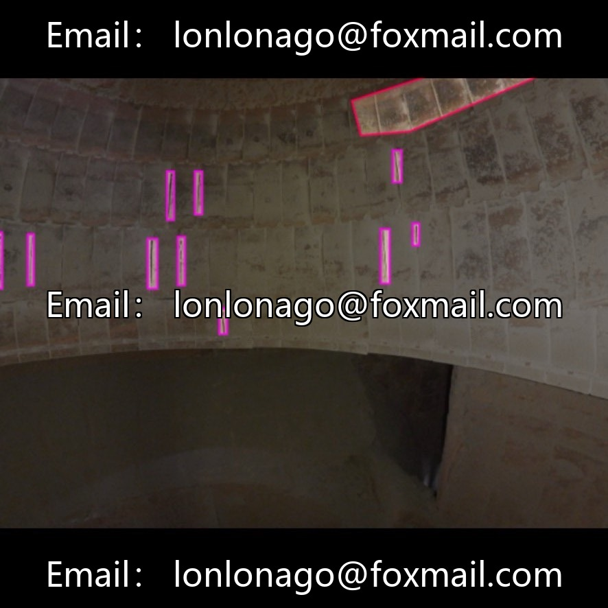
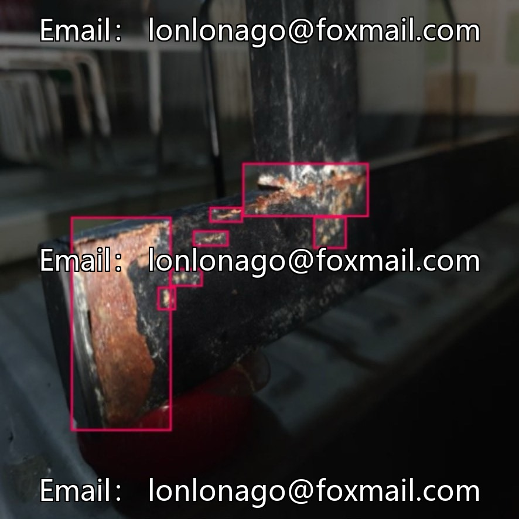

# Building concrete defect identification dataset (crack/corrosion/hole detection) | Item 103

## Body

Building concrete defect identification dataset (crack/corrosion/hole detection) | Issue 10367

The dataset contains 4,000 images of concrete surface defects in industrial and architectural scenarios, covering 6 common types of defects: cracks, corrosion, holes, gaps, material deposition, etc. It is suitable for research and system development of target detection, classification, semantic segmentation, etc.

Task Type: Object Detection (Defective Detection
Total Images: 4,000
Number of Categories: 6
Annotation Format: YOLO format
Data splitting: Training set/Validation set, specific ratios can be adjusted.

Virtual materials, once sold, are non-refundable.
Interested friends, click "I want" to proceed.

## Images

## Payment

Here is a pay link on Stripe ( https://buy.stripe.com/3cs8yP7sY87d0vu9AB ). Please contact me lonlonago@foxmail.com after funding $89, and I will send you a complete data files , thank you!

